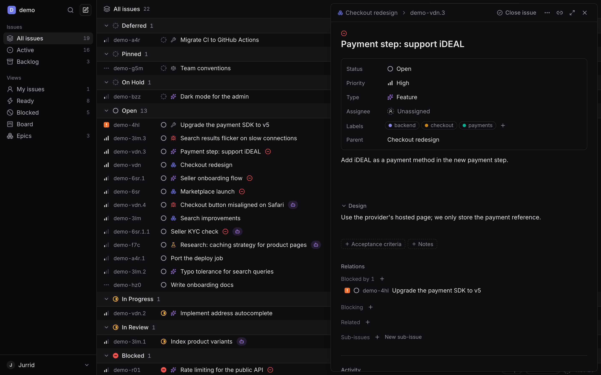
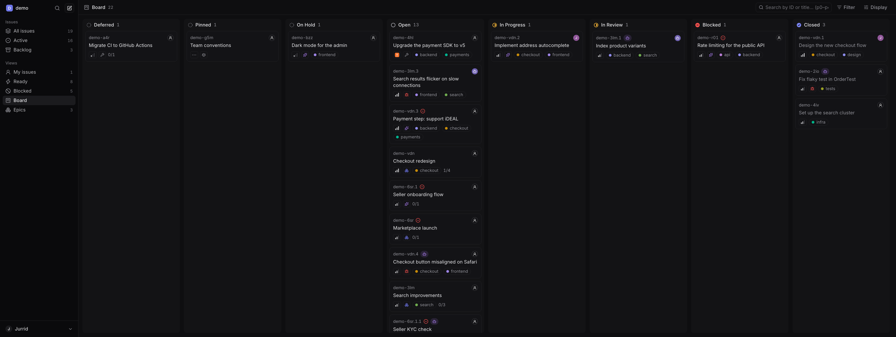
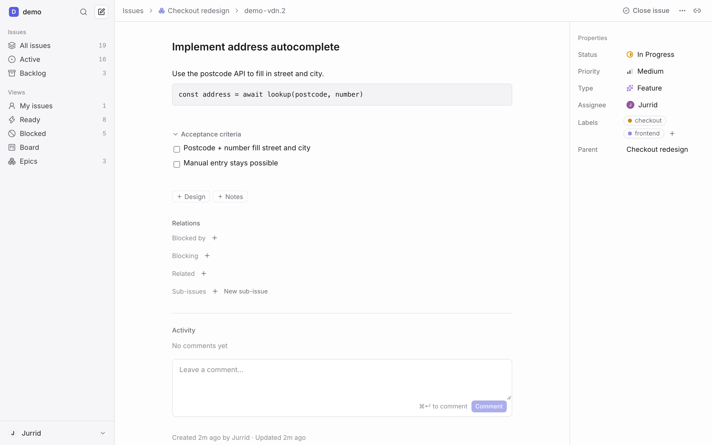

<p align="center">
  <picture>
    <source media="(prefers-color-scheme: dark)" srcset="art/logo-dark.svg">
    
  </picture>
</p>

<p align="center">
  <a href="https://packagist.org/packages/codeberry/beads-for-laravel"></a>
  <a href="https://github.com/codeberrynl/beads-for-laravel/actions/workflows/run-tests.yml"></a>
  <a href="https://packagist.org/packages/codeberry/beads-for-laravel"></a>
  <a href="LICENSE.md"></a>
</p>

<p align="center">
  A fast, Linear-style UI for <a href="https://beads.gascity.com/">beads</a> (<code>bd</code>) issue tracking,<br>
  right inside your Laravel app.
</p>

<p align="center">
  
</p>

---

[beads](https://beads.gascity.com/) is a git-friendly issue tracker that lives in your repository
and that AI coding agents use to plan and track their work. **Beads for Laravel** gives you and your
team a proper interface on top of it: browse, triage and edit the same issues your agents work on,
and watch their changes arrive live.

- **bd stays the source of truth.** The package only talks to the `bd` CLI. It stores no tickets of
  its own and never touches your app's code or database.
- **Local only.** Routes, UI and commands exist only in the `local` environment.
- **Made for working alongside agents.** Changes made from the CLI show up within seconds, authors
  outside your team get an agent badge, and when an agent edits a text you are editing, you get a
  conflict bar instead of a silent overwrite.

## Features

- **Issue list** grouped by status, priority, type or assignee, with filters, sorting and search
  (`p0`–`p4` included) that live in the URL, so every view can be shared.
- **Board** with a column per bd status, custom statuses included, and drag and drop.
- **Epics** with progress bars and their sub-issues.
- **Ready and Blocked** views that match `bd ready` and `bd blocked` exactly, and show what each
  issue waits on.
- **Side-peek and full-page detail** with property pickers, relations (blocked by, blocking,
  related, sub-issues), comments, and close, reopen or force close.
- **Markdown editor** (Tiptap) that autosaves, only writes when you really changed something, and
  opens content it cannot keep losslessly (raw HTML, footnotes, tables) as markdown source.
- **Keyboard first:** `⌘K` command menu, `C` to create, `J`/`K` to move, `/` to search.
- **Light and dark** themes, following your system or your choice.
- **Health screens** that tell you exactly what to run when bd is missing, too old, not initialised
  or needs a migration.

## Screenshots

<table>
  <tr>
    <td width="50%"></td>
    <td width="50%"></td>
  </tr>
  <tr>
    <td align="center"><sub>Board, with a column per bd status</sub></td>
    <td align="center"><sub>Issue detail in the light theme</sub></td>
  </tr>
</table>

## Requirements

- PHP 8.4 or newer
- Laravel 12 or 13
- [bd](https://beads.gascity.com/) 1.3.0 or newer, with a workspace (`bd init`) in your project

## Installation

Install the package as a dev dependency:

```bash
composer require --dev codeberry/beads-for-laravel
```

Then run the installer:

```bash
php artisan beads:install
```

It publishes `config/beads.php` and the compiled UI to `public/vendor/beads`, and offers to add a
hook to the `post-update-cmd` scripts in your `composer.json`. With that hook the UI assets stay in
sync after every `composer update`:

```json
"post-update-cmd": [
    "@php artisan vendor:publish --tag=beads-assets --force"
]
```

Pass `--hook` or `--no-hook` to answer without a prompt.

Open `/beads` in your app, for example `http://my-app.test/beads`.

### Updating

After updating the package, publish the new assets (the hook above does this for you):

```bash
php artisan beads:publish
```

If you forget, the UI shows a banner with this command.

### Laravel Herd and other PHP-FPM setups

Herd's PHP-FPM clears the environment, so web requests have no `PATH`, `HOME` or `USER`. The
package never relies on them:

- `bd` is called with an **absolute path**. Without `BEADS_BINARY` it looks in
  `/opt/homebrew/bin/bd`, `/usr/local/bin/bd`, `~/go/bin/bd` and `~/.local/bin/bd`, in that order.
  Set `BEADS_BINARY` when your bd lives elsewhere, or when an older bd comes first.
- `HOME` comes from the system user database, and `PATH` is the binary's directory plus
  `/usr/bin:/bin`.

## Usage

### Keyboard shortcuts

| Key | Action |
|---|---|
| `⌘K` / `Ctrl+K` | Command menu: search issues, navigate, create |
| `C` | Create an issue (prefilled from where you are) |
| `/` | Search the current list or board |
| `J` / `K` (or ↓ / ↑) | Next / previous issue, also while the side-peek is open |
| `Enter` | Open the issue in the side-peek |
| `Esc` | Close the side-peek or dialog |
| `⌘Enter` | Save the text you are editing, post a comment or create the issue |

Shortcuts never fire while you type in a field.

### Working with agents

Run your agents as usual. Everything they do with `bd` appears in the UI within a few seconds. To
tell people and agents apart, list the humans in the config: every other author gets an agent
badge.

```php
// config/beads.php
'humans' => ['Jurrid', 'Alex'],
```

Changes made from the UI are recorded in bd as the actor: `BEADS_ACTOR`, or else
`git config user.name` of the workspace.

## Configuration

Every option can be set from `.env` or in `config/beads.php`.

| Option | Env | Default | Meaning |
|---|---|---|---|
| `enabled` | `BEADS_ENABLED` | `true` | Set to `false` to switch the UI off, also locally. |
| `path` | `BEADS_PATH` | `base_path()` | The directory that contains `.beads`. |
| `binary` | `BEADS_BINARY` | auto-detect | Absolute path to `bd`. A configured path always wins. |
| `actor` | `BEADS_ACTOR` | `git config user.name` | The actor bd records for changes from the UI. |
| `humans` | – | `[actor]` | Authors not listed here get an agent badge. |
| `route.prefix` | `BEADS_ROUTE_PREFIX` | `beads` | The URL prefix. |
| `route.domain` | `BEADS_DOMAIN` | `null` | Serve the UI on its own domain. |
| `route.middleware` | – | `['web']` | Sessions and CSRF protection come from `web`. |
| `poll_interval` | – | `3` | Seconds between live-update polls. |
| `closed_window_days` | – | `30` | Closed issues newer than this load by default. |
| `lock_timeout` | – | `10` | Seconds to wait for the workspace lock before a retry. |
| `process_timeout` | – | `30` | Seconds a single bd call may take. |

### Access

The UI only exists when `app()->isLocal()` and `beads.enabled` is not false. Every request also
passes the `viewBeads` gate. The package defines it (allowing everyone, guests included) only when
your app has not, so you can restrict it:

```php
// app/Providers/AppServiceProvider.php
use Illuminate\Support\Facades\Gate;

Gate::define('viewBeads', fn (User $user) => $user->is_admin);
```

## Health screens

When something is wrong, the UI shows a full screen with the commands to fix it:

| State | Cause | Fix |
|---|---|---|
| `binary_missing` | No bd found, or `BEADS_BINARY` points nowhere. | `brew install beads`, or set `BEADS_BINARY`. |
| `version_too_old` | bd is older than 1.3.0. | `brew upgrade beads` |
| `workspace_missing` | No `.beads` directory in the workspace. | Run `bd init` there, or set `BEADS_PATH`. |
| `schema_migration_required` | The bd database is behind the binary. | Run `bd migrate schema` in the workspace. |

## How it works

- **No shell, one call at a time.** Every bd call is an argument array (values always as
  `--flag=value`, free text after `--`), runs with `--json --sandbox` (and `--readonly` for reads),
  and goes through a per-workspace file lock. bd's embedded Dolt store does not survive concurrent
  calls, and even reads write to it.
- **Cheap live updates.** The browser polls a snapshot every few seconds. The server compares a
  fingerprint of the files in `.beads` with the one it recorded after its own last call; only a
  change triggers a new `bd export`. An unchanged workspace answers `304 Not Modified` without
  calling bd at all.
- **Ready and blocked in PHP.** Both are derived from one export and verified against
  `bd ready` and `bd blocked`, including blocking that passes down from a parent to its children.
- **Safe editing.** Pickers save directly and optimistically, and roll back with bd's own message
  when bd refuses. Text fields send the value they started from, so an edit made elsewhere in the
  meantime becomes a conflict you resolve instead of a lost change.

The snapshot is cached in `storage/framework/beads`, independent of your cache driver.

## Not (yet) included

Deleting issues, bulk actions, a dependency graph, manual ordering, more than one workspace per
app, and `bd init`, `sync`, `push` or `pull` from the UI. The UI is in English and ready for
translation. Ideas are welcome in the [discussions](https://github.com/codeberrynl/beads-for-laravel/discussions).

## Contributing

Contributions are welcome. [CONTRIBUTING.md](CONTRIBUTING.md) explains how to set up the workbench,
run the tests and send a pull request.

## Security

Found a security issue? Please report it privately; see [SECURITY.md](SECURITY.md).

## Credits

- Jurrid at [Codeberry](https://codeberry.nl)
- [All contributors](https://github.com/codeberrynl/beads-for-laravel/contributors)
- Built on [beads](https://beads.gascity.com/), [Vue](https://vuejs.org), [Tiptap](https://tiptap.dev),
  [reka-ui](https://reka-ui.com) and [shadcn-vue](https://www.shadcn-vue.com).

## License

The MIT License (MIT). See [LICENSE.md](LICENSE.md).
